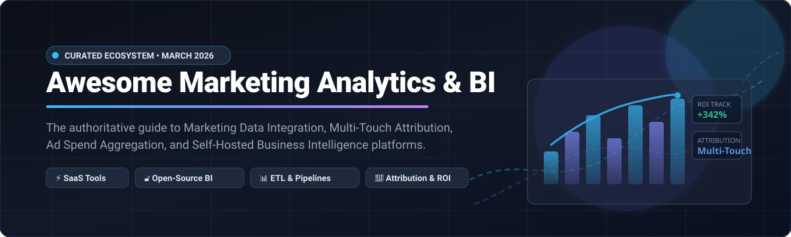
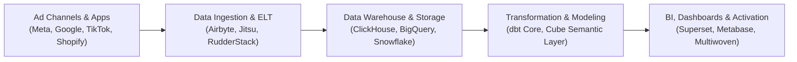

# 📊 Awesome Marketing Analytics & BI

  <b>A curated catalog of leading SaaS tools and production-grade Open-Source platforms for Marketing Analytics, Ad Data Integration, Attribution Modeling, and Business Intelligence (BI).</b>

  <a href="#-sector-overview--market-dynamics">Sector Dynamics</a> •
  <a href="#-saas-marketing-analytics--bi-platforms">SaaS Platforms</a> •
  <a href="#-open-source-marketing-analytics--bi-projects">Open-Source Projects</a> •
  <a href="#-marketing-data-stack-architecture">Architecture</a> •
  <a href="#-how-to-contribute">Contribute</a> •
  <a href="#-support--sponsorship">Support</a> •
  <a href="#-star-history">Star History</a>

---

## 🔍 Overview & SEO Highlights

Welcome to the **Awesome Marketing Analytics & BI** knowledge hub! Marketing teams, growth hackers, data engineers, and revenue operations leaders rely on modern analytics to unify fragmented advertising channels (Meta Ads, Google Ads, TikTok Ads, LinkedIn Ads, Amazon Ads), customer data platforms (CDPs), CRM touchpoints (Salesforce, HubSpot), and web/mobile telemetry.

Whether you are looking for turn-key enterprise SaaS with automated data connectors or seeking self-hosted, GDPR/CCPA-compliant open-source data stacks with zero vendor lock-in, this list provides clear comparisons of pricing tiers, free tier capabilities, market valuations, and GitHub community traction.

---

## 🌐 Sector Overview & Market Dynamics

> The global Marketing Analytics and Business Intelligence software market is estimated at **$6.5B – $8.2B in 2026** (growing at a ~14.8% CAGR toward $15B+ by 2032), driven by privacy changes (third-party cookie deprecation, Apple ATT) and the demand for cross-channel ad ROI attribution.
> The market is **moderately fragmented**: mega-cap cloud incumbents (Salesforce, Alphabet/Google, Microsoft) dominate consolidated enterprise suites, while best-of-breed specialized vendors (Supermetrics, Funnel.io, Improvado, Singular, Triple Whale) and rapidly expanding open-source alternatives capture massive mid-market and privacy-first developer adoption.

---

## 🏢 SaaS Marketing Analytics & BI Platforms

Below is a comprehensive comparison of category-leading hosted SaaS platforms for marketing data consolidation, attribution, and executive reporting. Entries are sorted descending by **Company Scale / Valuation / Revenue**.

| Company / Product 🚀 | Market Scale / Valuation / Revenue 💰 | Starting Pricing 🏷️ | Free Tier Limits / Free Trial 🎁 | Core Focus & Key Capabilities 💡 |
| :--- | :--- | :--- | :--- | :--- |
| **[Salesforce Marketing Cloud Intelligence](https://www.salesforce.com/)** *(formerly Datorama)* | **~$280B+ Market Cap** (~$35B+ FY25 Annual Revenue) | **$3,000 / month** (billed annually for Starter tier) | **30-day guided sandbox demo trial** (sales-assisted, no perpetual free tier) | Enterprise marketing BI unifying multi-channel ad spend, attribution modeling, predictive AI insights, and executive dashboards. |
| **[Looker Studio](https://lookerstudio.google.com/)** *(Google / Alphabet)* | **~$2.1T+ Market Cap** (Parent Alphabet; ~$350B+ Annual Revenue) | **$9 / user / month** for Looker Studio Pro (Enterprise add-on) | **100% Free Forever** (free tier includes unlimited dashboard reports, 800+ connectors, up to 50 components per report) | Free self-service BI and marketing dashboard builder with native connectors to Google Ads, GA4, BigQuery, and YouTube. |
| **[Supermetrics](https://supermetrics.com/)** | **~$400M+ Valuation** (~$70M+ ARR, backed by Highland Europe & IVP) | **$29 / month** (Single connector to Google Sheets/Looker Studio, billed annually) | **14-day full-featured free trial** (access to all 100+ connectors, no credit card required; no perpetual free tier) | Gold-standard marketing ETL engine streaming data from 100+ ad/social networks directly into Sheets, Looker Studio, PowerBI, and data warehouses. |
| **[Funnel.io](https://funnel.io/)** | **~$300M+ Valuation** (~$40M+ ARR, backed by Eight Roads & F-Prime) | **$400 / month** (Starter plan with automated exports to BI tools) | **Free Forever plan** (up to 3 data sources, 5 destinations, 350 flex points; plus 14-day trial of paid tiers) | Automated marketing data hub that collects, cleans, normalizes, and currencies-adjusts disparate campaign metrics before delivery to BI. |
| **[Singular](https://www.singular.net/)** | **~$200M+ Valuation** (~$30M+ ARR, backed by Norwest Venture Partners) | **$1,000 / month** (Standard plan for cross-platform attribution & cost aggregation) | **30-day free trial** with full attribution and marketing ROI features (custom demo signup required; no perpetual free tier) | Unified mobile attribution (MMP), ad spend aggregation, fraud prevention, and cross-device ROI analytics across web, mobile, and CTV. |
| **[Improvado](https://improvado.io/)** | **~$150M+ Valuation** (~$25M+ ARR, backed by UpHonest Capital & Bullpen) | **$1,250 / month** (Core plan with pre-built marketing ETL pipelines) | **14-day free trial** (sales-provisioned sandbox with custom connector testing; no perpetual free tier) | Enterprise marketing data pipeline platform automating extraction from 500+ sources, data transformation, governance, and warehouse sync. |
| **[Triple Whale](https://www.triplewhale.com/)** | **~$120M+ Valuation** (~$20M+ ARR, $52M total funding led by NFX) | **$129 / month** (Growth tier for stores up to $1M annual GMV) | **Free Forever plan** (available for stores under $250k GMV; includes basic attribution dashboard & summary metrics) | E-commerce marketing operating system for direct-to-consumer (D2C) brands with first-party pixel attribution (Triple Pixel) and AI forecasting. |
| **[Adverity](https://www.adverity.com/)** | **~$100M+ Valuation** (~$20M+ ARR, $120M total funding led by SoftBank) | **$500 / month** (Standard tier for mid-market data teams) | **14-day free trial** (includes sample connector pipeline mapping and dashboard generation; no perpetual free tier) | Mid-market and agency marketing data integration platform offering automated transformations, data governance, and multi-tenant workspace isolation. |
| **[Polar Analytics](https://www.polaranalytics.com/)** | **~$45M+ Valuation** (~$8M+ ARR, backed by Point Nine & Frst) | **$300 / month** (Starter tier for up to 5 integrated marketing channels) | **14-day full-access free trial** (connect Shopify + 3 ad platforms, unlimited dashboard seats; no perpetual free tier) | Modular multi-channel intelligence hub built for modern Shopify brands, combining blended CAC, LTV cohort analysis, and automated alerting. |
| **[DashThis](https://dashthis.com/)** | **~$25M+ Valuation** (~$6M+ ARR, bootstrapped & highly profitable) | **$45 / month** (Individual tier: 3 automated dashboards, unlimited integrations) | **15-day free trial** (includes 3 free dashboard creations with unlimited integrations, no credit card required) | Automated digital marketing reporting platform engineered for agencies, offering pre-configured KPI templates and white-labeled client portals. |

---

## 🔓 Open-Source Marketing Analytics & BI Projects

A curated, developer-friendly list of open-source tools powering the modern data stack for marketing analytics. Each repository includes a real-time Stars_Badge linked directly to its stargazers page. Sorted descending by **GitHub_Stars ⭐**.

| Project & Repository 🛠️ | GitHub_Stars 🌟 | Primary Stack 💻 | Description & Key Marketing Capabilities 📋 |
| :--- | :--- | :--- | :--- |
| **[Grafana](https://github.com/grafana/grafana)** |  | Go, TypeScript, React | The premier open observability and interactive visualization platform; widely utilized to build real-time campaign performance and ingestion monitoring dashboards. |
| **[Apache Superset](https://github.com/apache/superset)** |  | Python, TypeScript, React | Enterprise-grade cloud-native BI platform featuring an intuitive no-code chart builder, high-speed SQL Lab, and support for almost every SQL data warehouse. |
| **[Metabase](https://github.com/metabase/metabase)** |  | Clojure, TypeScript | The quintessential self-service BI tool. Allows non-technical growth and marketing team members to filter, segment, and visualize customer cohorts and acquisition KPIs. |
| **[Apache Airflow](https://github.com/apache/airflow)** |  | Python | Programmatic workflow orchestration platform for scheduling ad network ETL extractors, conversion syncs, and data mart transformations. |
| **[PostHog](https://github.com/PostHog/posthog)** |  | Python, TypeScript, ClickHouse | All-in-one product and marketing analytics platform with funnel analysis, session replays, feature flags, A/B experimentation, and custom event tracking. |
| **[Umami](https://github.com/umami-software/umami)** |  | Next.js, Prisma, PostgreSQL/MySQL | Modern, privacy-focused, cookie-free web analytics alternative to Google Analytics with built-in UTM campaign tagging and revenue tracking. |
| **[Plausible](https://github.com/plausible/analytics)** |  | Elixir, ClickHouse, Tailwind | Lightweight, GDPR-compliant web analytics delivering actionable traffic source insights and conversion goal tracking with sub-1KB script footprint. |
| **[Prefect](https://github.com/PrefectHQ/prefect)** |  | Python | Resilient Python data workflow orchestration engine with native dynamic task mapping, ideal for distributed marketing data pipelines. |
| **[Listmonk](https://github.com/knadh/listmonk)** |  | Go, PostgreSQL, Vue.js | High-performance, self-hosted newsletter and mailing list manager with analytics tracking for email campaigns, subscriber lifecycles, and deliverability. |
| **[Airbyte](https://github.com/airbytehq/airbyte)** |  | Java, Python | Industry-leading ELT data integration engine featuring 300+ pre-built connectors for Facebook Ads, Google Ads, TikTok, HubSpot, and Stripe into cloud warehouses. |
| **[Matomo](https://github.com/matomo-org/matomo)** |  | PHP, JavaScript, MySQL | Comprehensive open-source web and mobile analytics platform with multi-touch attribution, SEO keywords, heatmaps, form analytics, and GDPR compliance. |
| **[Cube Core](https://github.com/cube-js/cube)** |  | Rust, TypeScript | Open-source universal semantic layer for AI and BI. Centralizes marketing metrics (CAC, LTV, ROAS, Churn) and delivers consistent definitions to downstream dashboards. |
| **[Dagster](https://github.com/dagster-io/dagster)** |  | Python, TypeScript | Data asset-centric orchestrator for building, testing, and observing marketing ELT transformations and machine learning churn models. |
| **[dbt Core](https://github.com/dbt-labs/dbt-core)** |  | Python, SQL | The standard framework for data transformation in the warehouse; transforms raw ad clicks and conversions into clean marketing data marts. |
| **[GrowthBook](https://github.com/growthbook/growthbook)** |  | TypeScript, Next.js, Node.js | Open-source A/B testing and experimentation platform that connects directly to existing data warehouses to calculate statistical conversion significance. |
| **[OpenPanel](https://github.com/Openpanel-dev/openpanel)** |  | Next.js, ClickHouse, PostgreSQL | Open-source product and growth analytics platform (Mixpanel alternative) featuring funnel analysis, cohort retention, session replay, and MCP server for AI queries. |
| **[Snowplow](https://github.com/snowplow/snowplow)** |  | Scala | Enterprise customer data infrastructure generating rich, first-party behavioral telemetry for real-time marketing attribution and audience activation. |
| **[Lightdash](https://github.com/lightdash/lightdash)** |  | TypeScript, Node.js, React | Modern Looker alternative tightly integrated with dbt. Marketing metrics defined in dbt models become accessible to business stakeholders instantly. |
| **[Jitsu](https://github.com/jitsucom/jitsu)** |  | Go, TypeScript, ClickHouse | High-throughput open-source event collection platform (Segment alternative) streaming raw website, app, and webhook event payloads to data warehouses. |
| **[RudderStack Server](https://github.com/rudderlabs/rudder-server)** |  | Go, TypeScript | Customer Data Platform (CDP) core engine for collecting and routing event data to analytics platforms, marketing destinations, and cloud data warehouses. |
| **[Talivia](https://github.com/talivia-group/talivia)** |  | TypeScript, Next.js, Tailwind | Self-hosted revenue analytics platform for SaaS founders; integrates Stripe/Polar payment data with web sessions for first/last-touch attribution. |
| **[Multiwoven](https://github.com/Multiwoven/multiwoven)** |  | Ruby on Rails, React | Open-source Reverse ETL platform (Hightouch/Census alternative) syncing modeled warehouse audience segments back into Salesforce, HubSpot, and ad channels. |
| **[Insights](https://github.com/mariusandra/insights)** |  | Node.js, React, PostgreSQL | Self-hosted visual BI platform (Looker Studio alternative) for PostgreSQL databases. Auto-detects table relations and generates interactive charts in seconds. |
| **[OWOX Data Marts](https://github.com/OWOX/owox-data-marts)** |  | JavaScript, SQL | Self-service analytics pipeline automating marketing reporting across Google Ads, Meta Ads, and TikTok directly into spreadsheet interfaces. |
| **[OverSeek](https://github.com/MerlinStacks/overseek)** |  | TypeScript, PostgreSQL, Redis | Self-hosted command center for WooCommerce store owners unifying store analytics, revenue attribution, inventory tracking, and customer retention. |
| **[OpenMetrics Analytics](https://github.com/blueorbitware/openmetrics-analytics)** |  | Go, Next.js, ClickHouse | High-throughput product analytics platform leveraging Redis Streams and ClickHouse for event tracking, funnel conversion analysis, and multi-tenant workspaces. |

---

## 🏗️ Marketing Data Stack Architecture

A modern marketing analytics and BI architecture is typically assembled from four modular layers:

1. **Ingestion & Collection**: Stream real-time events via [Jitsu](https://github.com/jitsucom/jitsu) or [RudderStack](https://github.com/rudderlabs/rudder-server); extract daily ad metrics via [Airbyte](https://github.com/airbytehq/airbyte).
2. **Central Storage**: Consolidate customer journeys and raw spend into analytical engines like [ClickHouse](https://github.com/ClickHouse/ClickHouse), PostgreSQL, or cloud warehouses.
3. **Data Modeling & Semantic Layer**: Harmonize cross-channel UTMs with [dbt Core](https://github.com/dbt-labs/dbt-core) and enforce consistent metric definitions via [Cube](https://github.com/cube-js/cube).
4. **BI & Activation**: Deliver self-serve analytics to marketing stakeholders using [Metabase](https://github.com/metabase/metabase) or [Apache Superset](https://github.com/apache/superset), and sync segments back into ad platforms with [Multiwoven](https://github.com/Multiwoven/multiwoven).

---

## 🤝 How to Contribute

Contributions are warmly welcomed! Help make this the most accurate and up-to-date repository on Marketing Analytics and BI:

1. 🍴 **Fork** this repository.
2. 🌿 Create a new branch: `git checkout -b feature/add-new-marketing-tool`.
3. 📝 Add or update tools following the table format (include official links, pricing details, and factual descriptions).
4. 🚀 Commit your changes and submit a **Pull Request**.

---

## 📜 Disclaimer

- This list is **community-curated** for educational and exploratory purposes. Inclusion does not imply official endorsement.
- All brand names, logos, and trademarks belong to their respective owners.
- When capturing user data, ensure strict compliance with privacy standards including **GDPR**, **CCPA**, and platform-specific API guidelines.

## 💖 Support & Sponsorship

Thank you so much for using and exploring **Awesome Marketing Analytics & BI**! Maintaining high-quality, up-to-date benchmarks, pricing breakdowns, and open-source directories takes ongoing research and dedication.

If you find this repository valuable, here are a few wonderful ways you can support the project:
- ⭐️ **Star this repository** to help others discover it across GitHub.
- 🍴 **Fork and contribute** by adding new tools, correcting pricing, or sharing data pipelines.
- 📢 **Share with peers**, your growth teams, or on social channels (LinkedIn, X, Reddit).
- ☕ **Buy me a coffee & become a sponsor**: Support independent open-source curation and developer tools via the [GitHub Sponsors Dashboard](https://github.com/sponsors/ishandutta2007).

---

##  Star History

---

  <b>Maintained with ❤️ for growth engineers, data analysts, and BI architects worldwide.</b>

